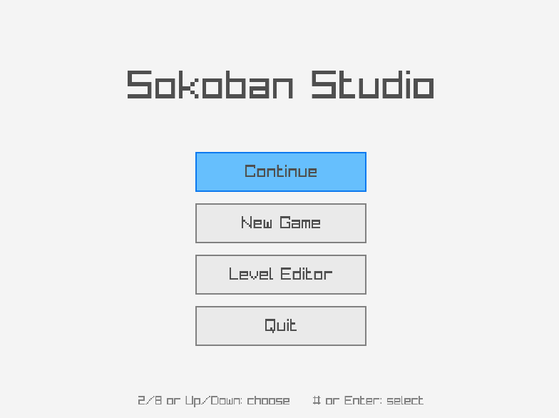
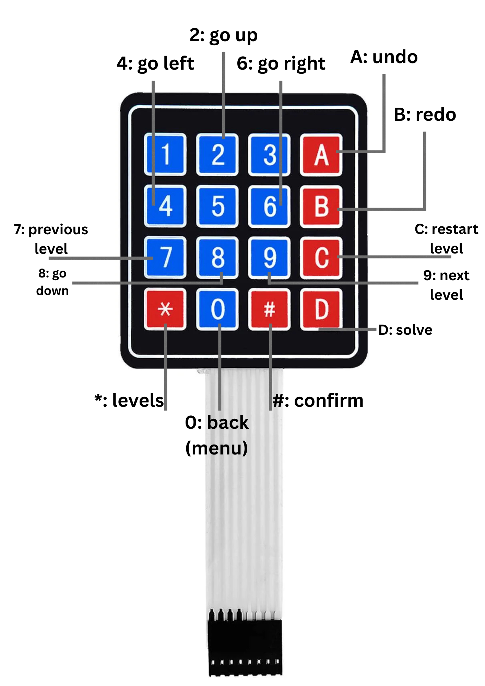
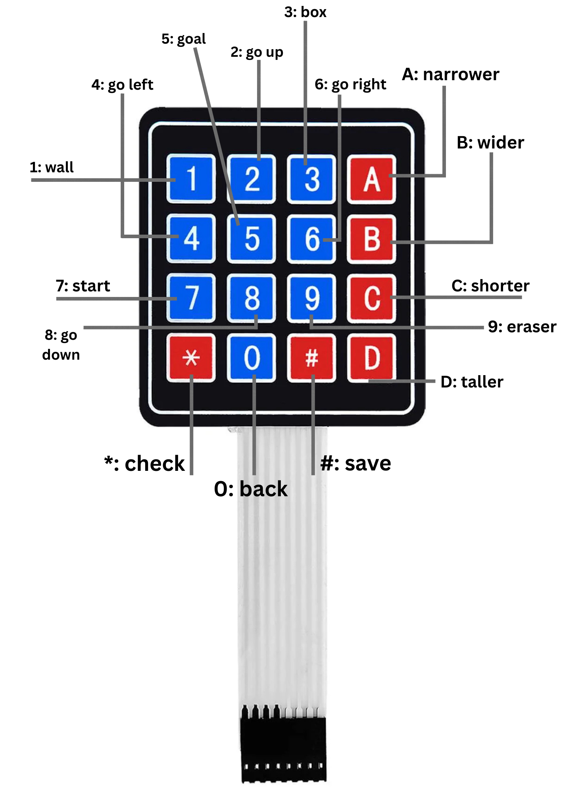
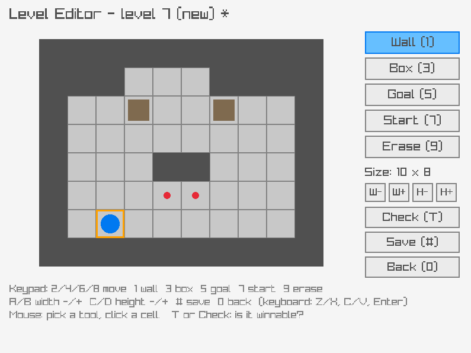

# Sokoban Studio

  

โปรเจคที่พวกเราทำเรียกว่า Sokoban Studio เป็นเกมที่สามารถเล่นผ่าน arduino keypad ได้ โดยมีองค์ประกอบหลักคือ หน้าเมนู หน้าเลือกด่าน หน้าเกม และหน้าแก้ไขด่าน

โปรเจคนี้สร้างด้วยภาษา C และ Raylib ช่วยในการสร้างเกม แล้ว compile ด้วย CMake เราใช้ Raylib ในการสร้างกราฟิกและจัดการอินพุตต่างๆจากคีย์บอร์ดหรือ Arduino
มีการจัดเก็บข้อมูลผู้เล่นและด่านด้วย text

อุปสรรคที่เจอคือ ตอนแรกไม่ได้ใช้ Keypad มาเป็น Controls ด้วยและพึ่งนึกขึ้นได้ว่าต้องมาใช้ตอนใกล้เขียนโค้ดเสร็จ
สิ่งที่เปลี่ยนคือ

- นำ Keypad 4x4 ต่อ Arduino มาใช้เป็น Controls และเขียนโค้ดเพิ่มเพื่อสนับสนุน
- ใช้แค่ Breadth-First Search และ Deadlock แทน A* ในการแก้ด่าน

ผลลัพท์ของโปรเจคคือเกมที่สมบูรณ์สามารถเล่นได้ และรับอินพุตจาก Arduino มาควบคุมได้ มีฟังก์ชั่นในการสร้างด่านในตัวเกมพร้อมอัลกอริทึมที่ช่วยในหาวิธีผ่านด่านได้ สิ่งที่คิดแต่ไม่ได้ทำคือมีหน้าหลักสำหรับการแชร์ด่านให้ผู้เล่นอื่นท้าทาย
เพราะเราจะทำด่านเองแก้เองเพื่ออะไร ทำไมเราไม่ทำให้ผู้เล่นได้สามารถสร้างด่านที่มีความท้าทายและให้ผู้เล่นอื่นๆได้ลองเอาชนะด่านที่แต่ละคนสร้างขึ้นมา
แต่อย่างน้อยด่านก็สามารถแชร์ได้ง่ายเพราะเป็นไฟล์ txt

68070205 หน้าที่: เขียน ตัวแก้โจทย์(solver) เขียน BFS, hint (40%) 68070314 หน้าที่: Raylib, เมนู UI, Level Editor, ออกแบบ level (30%) 68070321 หน้าที่: เขียน control เดิน, ดันกล่อง, ระบบ save (30%)

## Controls

### (game controls)

  

### (editor controls)

  

## Level Editor

  

## How it relates to DSA:

- Undo/Redo: uses stacks to store states (stack.c)
- Solve/Check: uses BFS (which also uses queue) to find the closest paths possible to push the boxes to the goal with hash table storing visited paths
